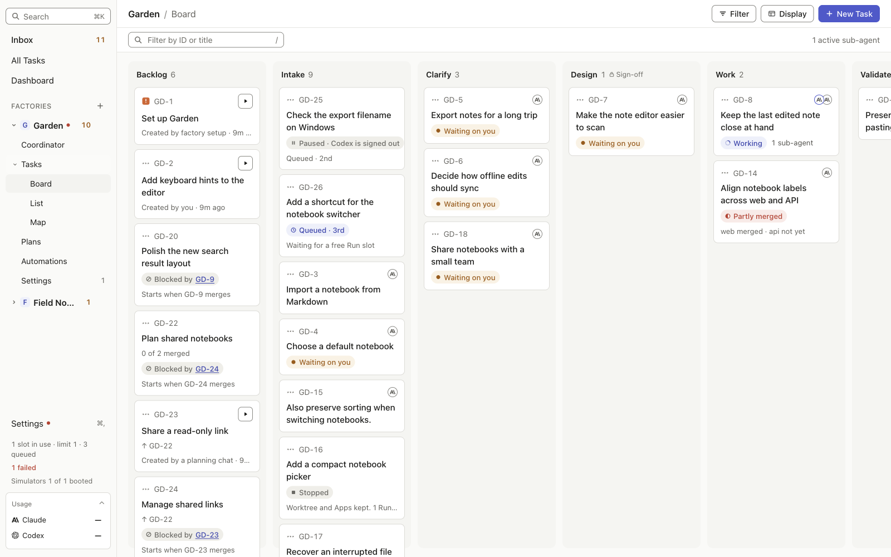

# Ted. Totally Excellent Development.

A software factory builder for solo developers, on your Mac.

You write a task. Agents design, write, test and review the change in your repository. A pull request arrives that has already passed your checks, and you decide whether it merges.

[Download for macOS](https://github.com/forjoyilive/ted/releases/latest) • [Website](https://tedandbill.com) • [What it does](https://tedandbill.com/what-it-does/) • [Discussions](https://github.com/forjoyilive/ted/discussions)



## What Ted does

Ted builds a factory for each of your projects. A factory takes every task through the same stages.

Every stage, check and sign-off can be changed per project. Turn sign-offs off and a task runs straight through.

| Stage | Who | What happens |
| --- | --- | --- |
| Intake | Agent | Ted reads the task and your repository and writes a brief. |
| Clarify | You | The agent asks what it needs to know. You answer. |
| Design | You | The agent proposes a plan or a prototype. You approve it or ask for changes. |
| Work | Agent | The agent builds the change in its own copy of your repository. |
| Validate | Agent | Your checks run and a second agent reviews the change. Problems go back to Work. |
| Review | You | You look at the result and sign off. |
| Merge | Agent | Ted waits for CI to pass and merges it, or leaves the merge to you. |

## Features

- **A loop that fixes things.** Work and Validate repeat until your checks pass and the reviewer has nothing left to report.
- **Work you can trust.** Require a sign-off after Clarify, Design or Review, or before Merge. Nothing gets past one without your yes.
- **A workspace per task.** Each task gets its own branch and working copy. Tasks never touch each other, or the folder you’re working in.
- **Claude Code, Codex, Antigravity or Pi.** One agent carries each task from start to finish and can hand parts of the job to sub-agents. Ted uses your own subscription or API key, or Pi’s own model setup.
- **Tasks from anywhere.** Write tasks in the app, or import them from GitHub, Linear and Asana.
- **As busy as you allow.** You set how many agents work at once. The rest wait in a queue, in the order you rank them, and new starts hold while your computer is busy.
- **A running app to look at.** Ted can start the task’s app (a web server, an iOS simulator or an Android emulator) so you see the real thing before you sign off.
- **Autopilot.** Ted answers routine questions with the agent’s recommended answer and approves routine sign-offs. Permission requests and failures still come to you. Check your services’ terms of service before leaving it on overnight.
- **Automations.** Run on a schedule to bring in new issues, audit your apps or run checks, and file tasks for what they find.
- **A dashboard.** Measure how the factory itself is doing, and improve it.
- **Your Inbox on your iPhone.** Pair a phone and answer most requests while you’re away from your Mac; see [Ted on your iPhone](docs/phone.md).
- **A sandbox.** Checks, setup commands and apps run in a macOS sandbox that can write only to the task’s own folders.

## Install

Ted runs on macOS today. [Join the waiting list](https://tedandbill.com/waiting-list/) to hear when there is a version for another platform.

1. Download the latest `.dmg` from [Releases](https://github.com/forjoyilive/ted/releases/latest) and drag Ted to Applications.
2. Open Ted and follow the setup screen.
3. Add a factory: point Ted at a GitHub repository, or at a folder it can set up a private repository for.

Ted updates itself from this repository’s releases.

### What you need

- Git, signed in the way you normally push to GitHub.
- The [GitHub CLI](https://cli.github.com) (`gh`), signed in.
- [Claude Code](https://claude.com/claude-code), [Codex](https://developers.openai.com/codex/cli) or [Antigravity](https://antigravity.google), signed in, or [Pi](https://www.npmjs.com/package/@earendil-works/pi-coding-agent) with a model set up.

Ted runs on your Mac with the logins already on it, and keeps its data in `~/.ted`.

## Reporting a problem

In the app, choose **Help → Report a problem**. Write what happened and, if you’d like a reply, your email. The window shows the diagnostic report, with tokens and URL passwords removed. Untick **Include the log** to leave out the daemon log and process command lines. Nothing is sent until you click **Send**. The report then goes to the Ted team through Sentry. **Open a GitHub issue instead** copies the report and opens a new issue for you to paste it into.

You can also [open an issue](https://github.com/forjoyilive/ted/issues/new) directly.

## Questions and ideas

Ask how to do something in [Q&A](https://github.com/forjoyilive/ted/discussions/categories/q-a), suggest a feature in [Ideas](https://github.com/forjoyilive/ted/discussions/categories/ideas), and share the factories you’ve built in [Show and tell](https://github.com/forjoyilive/ted/discussions/categories/show-and-tell). Release notes and news go to [Announcements](https://github.com/forjoyilive/ted/discussions/categories/announcements).

## Building from source

You need Node 24 and pnpm 10.

```sh
pnpm install
pnpm app
```

`pnpm app` builds the interface and opens Ted Dev. Ted Dev keeps its data in `~/.ted-dev`, has its own name and settings, and runs side by side with an installed Ted without touching it.

To look around without connecting any accounts, click **Try with sample data** on Set up Ted in the installed app, or open the demo from source. It has sample factories and tasks and uses stand-ins for the agents and GitHub:

```sh
pnpm app --demo
```

Other commands:

| Command | What it does |
| --- | --- |
| `pnpm ted <args>` | Runs the `ted` command line from source. `pnpm ted help` lists every command. |
| `pnpm typecheck` | Checks types. |
| `pnpm lint` | Checks formatting and lint rules with Biome. `pnpm format` fixes them. |
| `pnpm test` | Runs the tests with Vitest. The full suite starts real daemons and Electron apps and takes a while. |
| `pnpm package --mac --dir` | Builds an unsigned app into `packages/app/dist/release/`. |

## How the code is organised

A pnpm workspace with four packages. Node and Electron run the TypeScript files directly; only the interface has a build step.

| Package | What it holds |
| --- | --- |
| `packages/protocol` | Shared types, paths and the client every other package uses to reach the daemon. |
| `packages/daemon` | The background service. It owns tasks, the queue, agents, git and GitHub. |
| `packages/cli` | The `ted` command, which agents and you use to talk to the daemon. |
| `packages/app` | The Electron app and its React interface. |

More to read:

- [`GLOSSARY.md`](GLOSSARY.md): the words Ted uses, such as Factory, Task, Stage, Run and Check.
- [`AGENTS.md`](AGENTS.md): the rules for changing the code, written for agents and useful for people.
- [`docs/agents/`](docs/agents): the rules for each area of the code, and the reasons for them.
- [`docs/testing/test-tooling.md`](docs/testing/test-tooling.md): how the tests share a machine.

## Contributing

Bug reports are welcome as [issues](https://github.com/forjoyilive/ted/issues), and questions and feature ideas in [Discussions](https://github.com/forjoyilive/ted/discussions). Ted doesn’t accept pull requests for now; see [CONTRIBUTING.md](CONTRIBUTING.md).

## License

Ted is licensed under the [Apache License, Version 2.0](LICENSE). Copyright 2026 Kriya Design LLC. See [NOTICE](NOTICE) for third-party code.

## Name and logo

The Apache License doesn’t grant permission to use Ted’s name or logo (section 6). If you distribute a modified version of Ted, give it a different name and logo.
